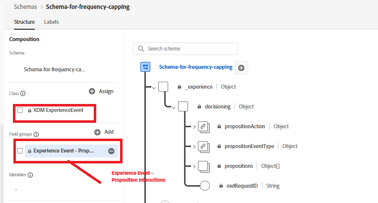
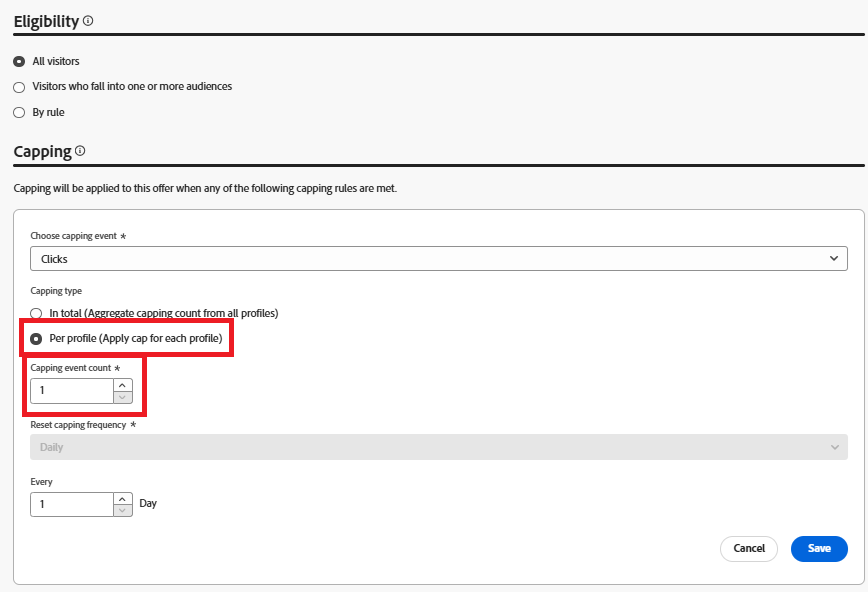
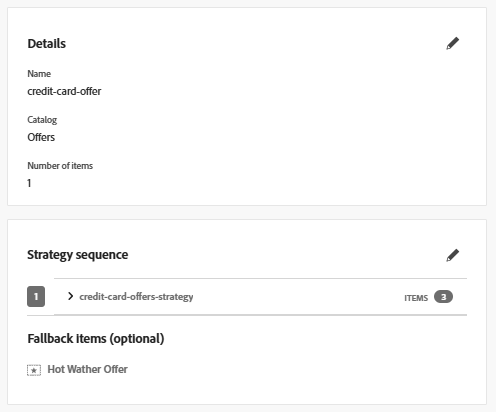
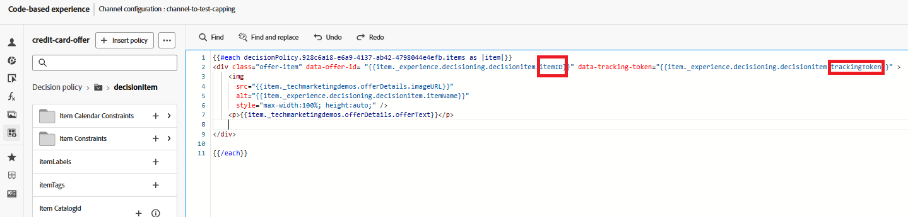

# Activation du capping de la fréquence pour une campagne AJO

Pour appliquer une limitation de la fréquence aux offres, procédez comme suit :

## Mise à jour du schéma d’événement

* Mettez à jour le schéma d’événement existant en ajoutant le groupe de champs comme illustré ci-dessous
* 

## Mettre à jour le capping de la fréquence pour l’offre

* 

## Ajouter un jeton de tracking à l&#39;offre

Modifiez la politique de décision utilisée dans la campagne en ajoutant une offre de secours

Vous pouvez ajouter les éléments trackingToken et ItemID en cliquant sur l’icône Politique de décision dans le volet de navigation de gauche, puis en faisant défiler l’arborescence de prise de décision pour sélectionner les éléments itemID et trackingToken.

Ajoutez l’identifiant d’élément et le jeton de suivi au div contenant l’offre, comme illustré ci-dessous

Cela garantit que chaque offre rendue inclut un jeton de suivi des données, essentiel pour un suivi précis des événements d’impression et de clic.

Activer la campagne modifiée.

## Envoi d’événements d’impression et de tracking

Modifiez le code JavaScript existant pour capturer et envoyer des événements d’impression et d’interaction d’offre à Adobe Experience Platform à l’aide de Adobe Web SDK. Reportez-vous à l’[exemple de code fourni ici.](capture-impression-click-events.md)
