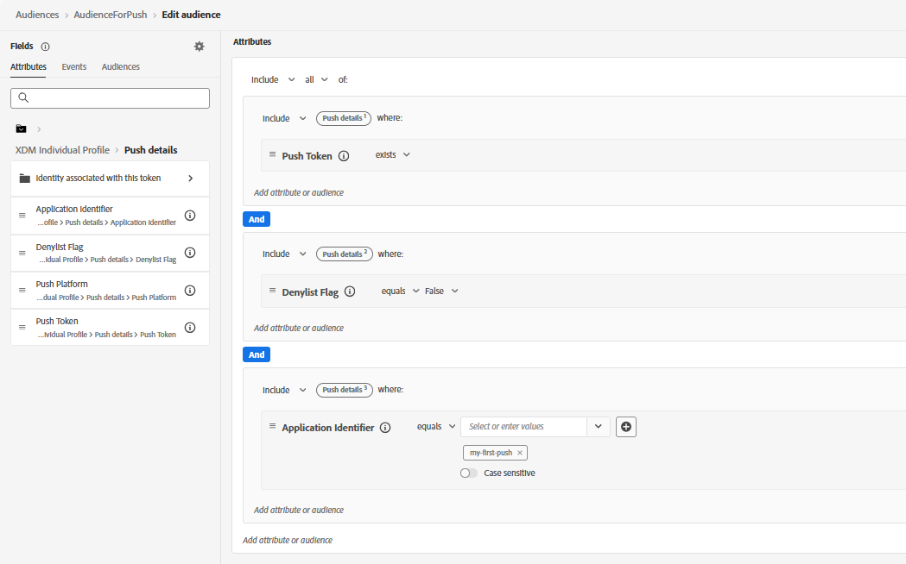

# Créer une audience

Pour créer une audience pour la campagne, définissez un segment dans Adobe Experience Platform qui cible les utilisateurs éligibles pour recevoir des notifications push. Dans ce tutoriel, les utilisateurs disposant d’un abonnement push actif (il existe un jeton push), ne se sont pas désinscrits des notifications (l’indicateur de Place sur la liste bloquée est false) et sont associés à la configuration d’application spécifiée (l’identifiant d’application est `my-first-push`). Ces utilisateurs et utilisatrices sont entièrement éligibles pour recevoir des notifications push web par le biais de campagnes ou de parcours dans Adobe Journey Optimizer. Après la création de l’audience, assurez-vous qu’elle a été évaluée afin que les profils soient renseignés et prêts pour le ciblage.
Cette audience est ensuite utilisée dans la campagne pour diffuser des messages push web planifiés uniquement aux utilisateurs abonnés.

