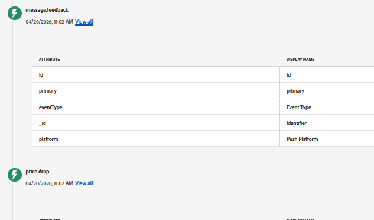

# Déboguer les notifications push Web dans AJO

Cette page fournit des conseils utiles pour déboguer le flux de notifications push web, notamment pour vérifier les requêtes Web SDK, l’ECID et le profil utilisateur dans AEP, et s’assurer que des événements tels que price.drop sont correctement envoyés et reçus.

- **Utilisation d’Adobe Experience Platform Debugger (extension Chrome)**\
  Installez l’extension [AEP Debugger pour Chrome](https://chrome.google.com/webstore/detail/adobe-experience-platform/bfnnokhpnncpkdmbokanobigaccjkpob) pour inspecter plus facilement l’activité de Web SDK :

Cet outil vous permet d’effectuer les opérations suivantes :
- Affichage des requêtes et des réponses de Web SDK\
- Vérifiez l’ECID (Experience Cloud ID).\
- Validation de la configuration du flux de données et des payloads

- **Vérifier si l’utilisateur est identifié (ECID)**\
  Utilisez le débogueur AEP ou la console du navigateur pour confirmer qu’un ECID est généré. Cet identifiant est utilisé pour effectuer le suivi de l’utilisateur dans AEP et AJO.

- **Utilisez l’onglet Réseau pour vérifier les requêtes**\
  Ouvrez l’onglet **Réseau** dans les outils de développement de votre navigateur et filtrez les requêtes effectuées par le SDK Web (recherchez `/collect` ou `interact`).
  - Les requêtes de confirmation sont envoyées au chargement de la page et au déclenchement des actions
  - Vérifiez que l&#39;événement `price.drop` est inclus dans la payload

- **Recherche du profil utilisateur dans AEP**\
  Utilisez l’ECID pour rechercher le profil de l’utilisateur dans Adobe Experience Platform. Cela permet de confirmer que l’utilisateur est reconnu et que ses données (comme l’abonnement push) sont correctement stockées.

- **Vérifiez que l’événement `price.drop` est reçu**\
  Après avoir déclenché l’événement à partir de la page web, archivez AEP si l’événement a été ingéré et associé au même ECID.
Recherchez `feedback.status` dans le fichier json de l’événement message.feedback . La valeur du statut doit être . `sent`
  

- **Confirmer que les notifications push sont activées**\
  Assurez-vous que :
  - L’utilisateur a accepté l’invite de notification du navigateur
  - Un jeton push existe dans le profil de l’utilisateur

- **Vérifier la configuration du parcours**\
  Assurez-vous que le parcours est publié et configuré pour écouter l’événement `price.drop`.
