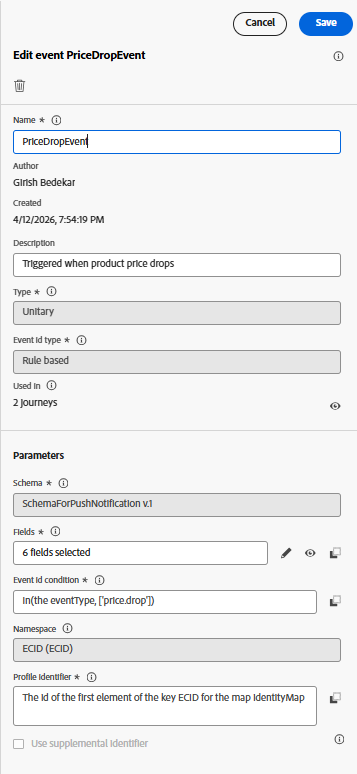

# Envoyer des messages push dans un parcours

Le déclenchement d’un parcours en fonction d’un événement de chute de prix permet un engagement en temps réel et axé sur le comportement avec les utilisateurs. Dans des scénarios réels, cet événement provient généralement d’un système de tarification principal lorsque le prix d’un produit est mis à jour. Dans ce tutoriel, nous simulons ce comportement en envoyant un événement price.drop personnalisé par le biais de la couche de données Adobe à l’aide de balises AEP, y compris des détails du produit tels que le nom et le SKU. Cet événement est ingéré dans Adobe Experience Platform et utilisé comme déclencheur d’entrée pour un parcours dans Adobe Journey Optimizer. Une fois reçu, le parcours peut envoyer immédiatement une notification push personnalisée aux utilisateurs et utilisatrices éligibles, les informant de la baisse du prix et les encourageant à agir en temps opportun.

Le déclenchement d’un parcours à l’aide d’un événement personnalisé implique les étapes suivantes

## Création d’un événement personnalisé dans Journey Optimizer

Connectez-vous à Adobe Journey Optimizer et accédez à Administration → Configurations → Événements, puis sélectionnez Créer un événement. Créez un événement nommé PriceDropEvent et associez-le au schéma d’événement SchemaForPushNotification créé précédemment dans le tutoriel. Assurez-vous que les propriétés de l’événement sont configurées comme illustré dans l’image de référence.

Dans le schéma , sélectionnez les champs requis pour les rendre disponibles pour la personnalisation. Plus précisément, incluez les `Name` et `SKU` de l’objet ProductListItems, ainsi que l’identifiant de l’identityMap. Ces champs seront ensuite accessibles dans l’éditeur de personnalisation, ce qui vous permettra de composer dynamiquement les messages de notification push en fonction du produit et du contexte utilisateur.

## Création d’une propriété de balise

Cette propriété est configurée avec AEP Web SDK, qui est connecté au WebPushDataStream créé précédemment dans le tutoriel. La propriété de balise écoute l’événement price.drop de la couche de données Adobe et mappe les détails du produit concerné en mettant à jour l’élément de données ProductListItems. Une fois les données préparées, une règle dans la propriété de balise se déclenche et envoie l’événement price.drop à AEP via le SDK Web. Cet événement sert ensuite de point d’entrée pour un parcours dans Adobe Journey Optimizer, ce qui permet la diffusion immédiate de notifications push en fonction de la baisse du prix.

