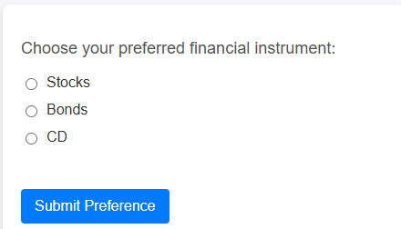

# Création d’un formulaire web

Le formulaire HTML suivant a été créé pour capturer la préférence des utilisateurs


Lorsqu’un utilisateur clique sur le bouton de la page web, ses préférences financières sélectionnées (telles que les actions, les obligations ou les CD) sont capturées et intégrées à la couche de données d’Adobe. Cet événement (assetClassSelection) stocke le choix de l’utilisateur en temps réel. Adobe Launch écoute ensuite cet événement, récupère l’option d’investissement sélectionnée (PreferredFinancialInstrument) et peut déclencher des actions telles que l’envoi des données à Adobe Experience Platform (AEP) ou la mise à jour des règles de personnalisation

Le code JavaScript suivant a été écrit pour gérer l’envoi du formulaire

```javascript
function handleSubmission() {
  window.adobeDataLayer = window.adobeDataLayer || [];

  const selectedAssetClass = document.querySelector('input[name="assetclass"]:checked');
  const errorMessage = document.getElementById("error-message");
  const messageBox = document.getElementById("message");

  if (!selectedAssetClass) {
    errorMessage.textContent = "Please select a financial instrument.";
    messageBox.textContent = "";
    return;
  }

  errorMessage.textContent = "";

  const subscriptionEvent = {
    event: "assetClassSelection",
    xdm: {
      eventType: "assetClassSelection",
      eventID: "investment_preference_event",
      timestamp: new Date().toISOString(),
      FinancialInterest: {
        PreferredFinancialInstrument: selectedAssetClass.value
      }
    }
  };

  console.log("📩 Sending asset class data to AEP:", subscriptionEvent);
  window.adobeDataLayer.push(subscriptionEvent);

  // ✅ Show thank-you message
  messageBox.textContent = `Thank you for selecting "${selectedAssetClass.value}". We'll use this to personalize your experience.`;
}
```

[L’exemple de formulaire HTML est fourni dans le cadre de ce tutoriel](assets/webform.zip)
