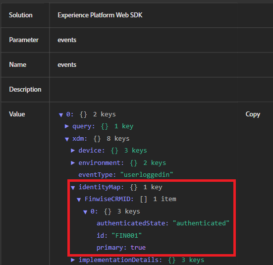

# Tester la combinaison d’identités

Cet exemple d’application simule un flux de connexion réel où les informations d’identification de l’utilisateur sont validées côté serveur avant l’envoi de l’identifiant de gestion de la relation client à Adobe Experience Platform (AEP). Un serveur Node.js local est utilisé pour diffuser en toute sécurité les pages web, gérer la logique d’authentification de base et éviter les restrictions du navigateur (telles que le blocage de l’accès aux fichiers locaux ou l’absence d’en-têtes CORS) qui pourraient interférer avec les fonctionnalités d’Adobe Launch ou de Web SDK. Cette configuration garantit que l’expérience est plus proche d’un environnement de production réel.

## Installation de node.js

Si Node.js n’est pas installé, téléchargez-le et [installez-le ici](https://nodejs.org/)

Vérifiez l’installation en exécutant :

`node -v`

`npm -v`

## Configurer le dossier du projet

Créez un nouveau répertoire pour l’exemple d’application à l’aide des commandes suivantes

`mkdir aep-demo`

`cd aep-demo`

## Initialiser le projet

`npm init -y`

## Installer Express (Web Server Framework)

`npm install express`

## Créer un fichier server.js

```javascript
const express = require('express');
const path = require('path');
const app = express();
const PORT = 3000;

// Serve static files from the current directory
app.use(express.static(__dirname));

app.listen(PORT, () => {
  console.log(`Server is running at http://localhost:${PORT}`);
});
```

## Ajouter HTML/Assets

Copiez tous les fichiers HTML et CSS fournis [&#128279;](assets/login-app-files.zip) dans ce dossier. Copiez et collez le script AEP Tags dans la section `<head>` du fichier index.html.

## Exécution du serveur

`node server.js`

## Test

Ouvrez l’URL du `http://localhost:3000`. La connexion utilise alice/pass123

## Utiliser AEP Debugger

Adobe Experience Platform Debugger est une extension de navigateur puissante qui permet de valider les données envoyées de votre site web vers Adobe Experience Platform. Il est particulièrement utile pour vérifier si identityMap est correctement configuré et transmis via Adobe Web SDK (alloy.js).

Utilisez le débogueur AEP pour tester les événements de connexion, vérifier l’assemblage des identités (par exemple, la transmission d’un ECID et d’un CRMID) et vous assurer que les règles et éléments de données AEP Tags se déclenchent comme prévu. Il offre une visibilité en temps réel sur les événements sortants, les informations d’identité et les payloads XDM, ce qui est essentiel pour résoudre les problèmes d’enrichissement des profils et de qualification des audiences.

La capture d’écran suivante montre la transmission correcte de l’identifiant « FIN001 ».


## Étapes de vérification de l’assemblage des identités dans AEP

* Connexion à AEP
* Accédez à Client -> Profils ->Parcourir
* Recherchez FinWise CRM ID = FIN001
* Ouvrez le profil et consultez la section Identités . Vous devriez voir les CRMID et ECID répertoriés.   Cela confirme que les deux identités ont été regroupées en un seul profil.


