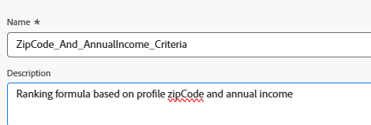

# Créer une formule de classement

Une formule de classement dans Adobe Journey Optimizer est utilisée lors de la prise de décisions sur les offres, en particulier dans le cadre d’une stratégie de sélection visant à déterminer l’ordre de priorité des offres éligibles. La formule de classement entre en jeu après le filtrage de l’éligibilité, lorsque plusieurs offres remplissent les critères d’un profil donné, mais que seule la première (ou quelques-unes) doit être présentée en fonction de la logique commerciale ou du contexte du profil.

* Connexion à Journey Optimizer

* Prise de décision ->Configuration de la stratégie ->Formules de classement ->Créer une formule

Formule De Classement


Un critère dans une formule de classement fait référence à une règle conditionnelle utilisée pour attribuer un score à une offre. Ces critères comparent les attributs de l’offre et le profil ou le contexte afin de déterminer la pertinence d’une offre pour un individu spécifique.


Critère 1

Cette condition filtre les éléments de décision (offres) **pour n’inclure que** les offres balisées avec « IncomeLevel ».
Ces offres filtrées passeront ensuite à l’étape suivante, telle que le classement ou la diffusion, en fonction de la logique supplémentaire que vous définissez.


L&#39;expression suivante est utilisée pour créer le score de classement

```pql
if(   offer._techmarketingdemos.offerDetails.zipCode = _techmarketingdemos.zipCode,   _techmarketingdemos.annualIncome / 1000 + 10000,   if(     not offer._techmarketingdemos.offerDetails.zipCode,     _techmarketingdemos.annualIncome / 1000,     -9999   ) )
```

Fonctionnement de la formule

* Si l’offre possède le même code postal que l’utilisateur ou l’utilisatrice, attribuez-lui un score très élevé afin qu’elle soit sélectionnée en premier.

* Si l’offre ne comporte aucun code postal (s’il s’agit d’une offre générale), attribuez-lui un score normal en fonction du revenu de l’utilisateur ou de l’utilisatrice.

* Si le code postal de l’offre est différent de celui de l’utilisateur ou de l’utilisatrice, attribuez-lui un score très faible afin qu’elle ne soit pas sélectionnée.

Ainsi, le système :

* Toujours essayer d’afficher d’abord une offre ZIP correspondante,

* Retourne à une offre générale si aucune correspondance n’est trouvée et évite d’afficher les offres destinées à d’autres codes postaux.


Si un élément d’offre ne répond à aucun des critères de filtre (comme ne pas avoir la balise « IncomeLevel »), l’offre reçoit un score de classement par défaut de 10.


