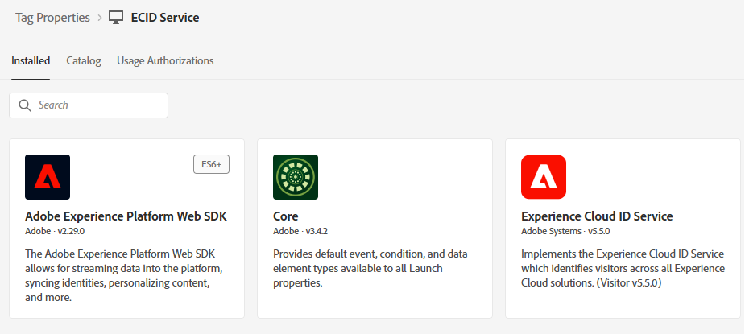
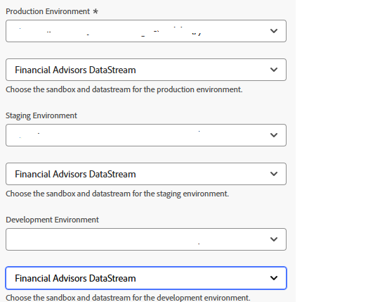
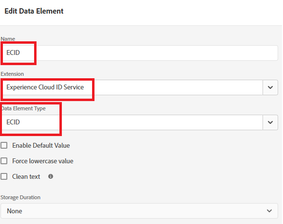

# Création de balises Adobe Experience Platform

Les balises Experience Platform sont configurées sur la page web pour charger le SDK web Adobe Experience Platform, ce qui permet à l’appel de l’API sendEvent de déclencher des expériences personnalisées. Cette configuration garantit que les bibliothèques côté client nécessaires sont correctement initialisées, ce qui permet une interaction en temps réel avec Adobe Journey Optimizer pour la diffusion d’offres.

1. Connectez-vous à Collecte de données .
1. Cliquez sur **[!UICONTROL Balises]** > **[!UICONTROL Nouvelle propriété]**.
1. Créez une balise Adobe Experience Platform appelée Service ECID.
1. Ajoutez les extensions suivantes à la balise :

   

1. Configurez le SDK Web Adobe Experience Platform pour utiliser l’environnement approprié et le flux de données Financial Advisors créé dans le tutoriel précédent

   

Aucune configuration supplémentaire n’est nécessaire pour les extensions principales et la couche de données client Adobe

## Création de l’élément de données

L’élément de données ECID dans les balises Experience Platform est créé uniquement à des fins de débogage et de test. L’élément de données permet aux développeurs d’afficher l’Experience Cloud ID attribué à la session de navigateur d’un utilisateur, ce qui peut aider à valider la combinaison d’identités et à s’assurer que les appels `sendEvent` sont associés au profil correct. Cet élément n’est pas nécessaire au fonctionnement de la personnalisation, mais il est utile lors de l’implémentation et de l’assurance qualité

## Inclure les balises AEP dans la page HTML

Créez et publiez les balises Adobe Experience Platform.

Lorsqu’une propriété AEP Tags est publiée, Adobe vous fournit une balise de script que vous devez placer dans votre `<head>` HTML ou au bas des balises `<body>`.

1. Accédez à la propriété Balises (service ECID) .

1. Cliquez sur Environnements, puis sur l’icône d’installation de l’environnement souhaité (par exemple, Développement, Évaluation, Production).

1. Notez le code incorporé.

   Ce code doit être placé juste avant la balise `</body>` de fermeture dans la page HTML.
