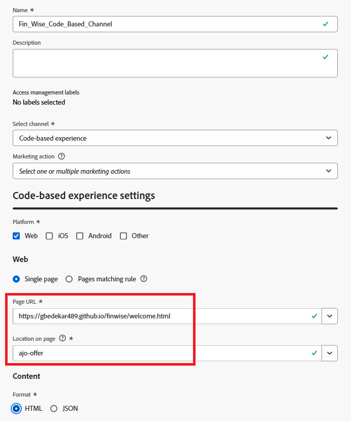

# Créer un canal d’expérience basé sur du code

Une expérience basée sur le code dans Adobe Journey Optimizer (AJO) [!UICONTROL Decisioning] est une configuration qui permet la diffusion d’offres personnalisées directement dans une page web à l’aide de JavaScript côté client. Au lieu de s’appuyer sur des modèles prédéfinis ou des outils de mise en page visuelle, cette approche permet aux développeurs et aux développeuses de contrôler entièrement quand et où les offres sont rendues à l’aide d’Adobe Web SDK (`Alloy.js`).

