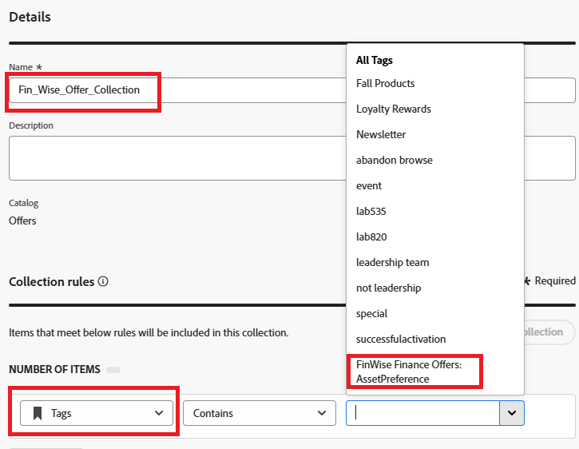

# Création d’une collection

Les collections vous permettent de classer et de regrouper vos éléments de décision en fonction de vos préférences. Ces catégories sont créées en élaborant des règles qui utilisent les attributs des éléments de décision.

1. Connectez-vous à Journey Optimizer.
1. Cliquez sur **[!UICONTROL Prise de décision]** > **[!UICONTROL Catalogues]** > **[!UICONTROL Collections]** > **[!UICONTROL Créer une collection]**.
1. Indiquez le nom de la collection et les règles de collection, comme illustré dans la capture d’écran suivante.

   
