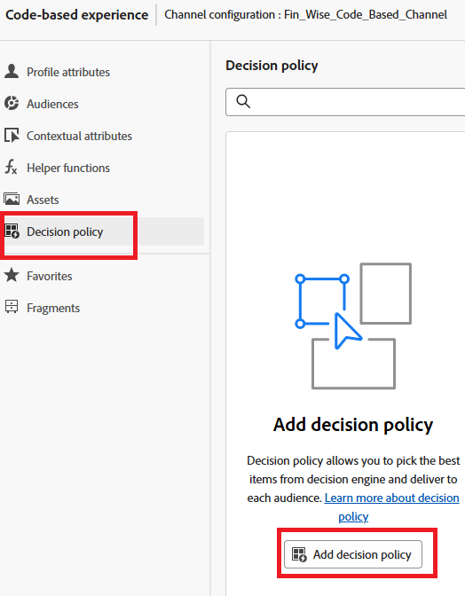
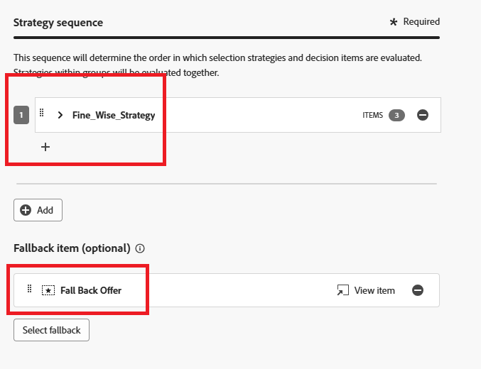
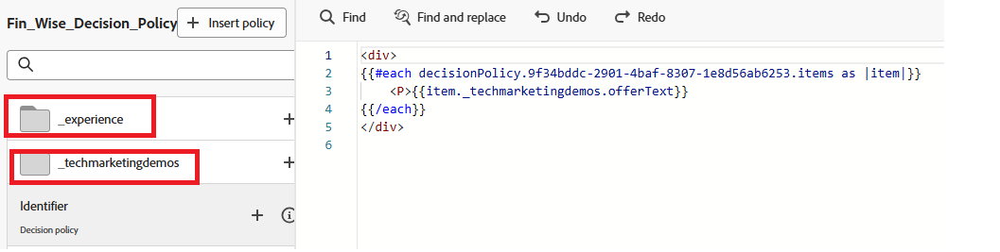

# Créer une politique de décision

Les politiques de décision sont des conteneurs pour vos offres qui s’appuient sur le moteur [!UICONTROL Decisioning] afin de sélectionner le meilleur contenu à diffuser en fonction de l’audience.

1. Dans l’éditeur de personnalisation, cliquez sur l’élément **[!UICONTROL Politique de décision]** dans le volet de navigation de gauche, puis cliquez sur **[!UICONTROL Ajouter une politique de décision]**.

   

1. Cliquez sur **[!UICONTROL Ajouter]** pour sélectionner la stratégie de sélection.

   

1. Cliquez sur **[!UICONTROL Sélectionner une offre de secours]** pour sélectionner l’offre de secours.
1. Cliquez sur **[!UICONTROL Suivant]** pour passer en revue la politique de décision.
1. Cliquez sur **[!UICONTROL Créer]** pour terminer le processus de création de la politique de décision.

## Utilisation de la politique de décision dans l’éditeur de code

1. Dans l’éditeur de personnalisation, cliquez sur **[!UICONTROL Insérer une politique]**.

   Le code correspondant à la politique de décision est ajouté.

   À ce stade, vous pouvez inclure tous les attributs de décision requis directement dans le code. Ces attributs sont définis dans le schéma utilisé par le catalogue d&#39;offres. Les attributs standard sont organisés sous l’espace de noms `__experience`, tandis que les attributs personnalisés spécifiques à votre organisation sont stockés sous l’espace de noms `_<imsOrg>`.

   

   Ce code parcourt une liste d’offres personnalisées choisies pour l’utilisateur et affiche le texte de chacune d’elles sur la page web. Il affiche le message (appelé `offerText`) de chaque offre dans un paragraphe, afin que les utilisateurs puissent voir clairement leur contenu personnalisé.

   Si aucune offre personnalisée n&#39;est disponible, une offre de secours s&#39;affiche pour vous assurer que l&#39;espace n&#39;est pas laissé vide.

1. Cliquez sur **[!UICONTROL Enregistrer]**, puis activez la campagne.
