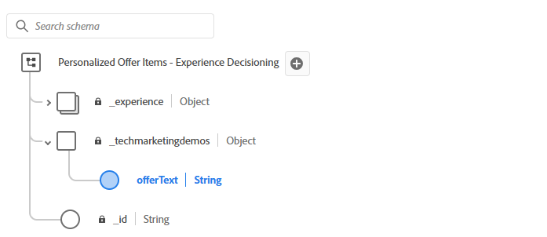
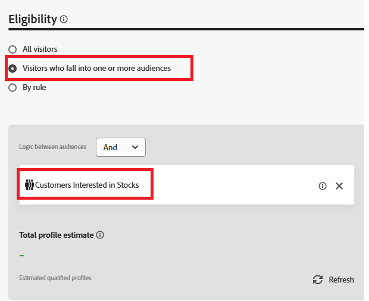
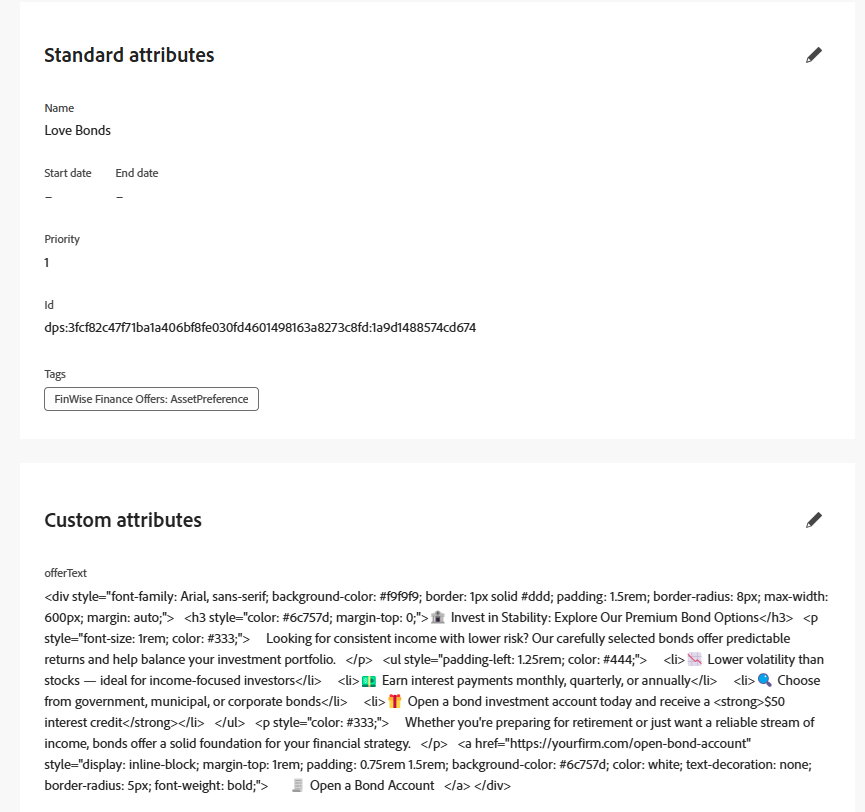

# Création d’une offre

Un élément d’offre dans AJO représente un élément unique de contenu personnalisé. Le contenu peut être une promotion, un message ou une recommandation diffusée à un utilisateur ou une utilisatrice, selon une logique de prise de décision.

Lorsque vous créez un élément d&#39;offre dans AJO, il doit être basé sur un [!UICONTROL Schéma de prise de décision]. Ce schéma définit la structure et les champs disponibles dans l’offre, tels que le titre, la description, imageURL, offerText, etc.

Ce schéma :

* Normalise le modèle de contenu pour toutes les offres d’une collection.

* Permet des champs de personnalisation cohérents entre les éléments d’offre.

* Active les stratégies de sélection pour faire correspondre les règles au contenu structuré

## Modification du schéma

1. Connectez-vous à Journey Optimizer.
1. Cliquez sur **[!UICONTROL Prise de décision]** > **[!UICONTROL Catalogues]** > **[!UICONTROL Modifier le schéma]**.
1. Ajoutez un élément de type `string` appelé `offerItem`, comme illustré ci-dessous

   

## Création d’un élément d’offre

1. Cliquez sur **[!UICONTROL Prise de décision]** > **[!UICONTROL Catalogues]** > **[!UICONTROL Créer un élément]**.

1. Créez trois offres : `Love Stocks`, `Love Bonds` et `Love CD`.

   Pour chaque offre, copiez et collez le texte de l’offre correspondante fourni à la fin de cet article dans l’élément d’offre approprié.

1. Balisez les offres à l’aide de la balise créée à l’étape précédente.
1. Ajoutez l’audience appropriée à chaque offre.
   
1. Valider les offres.

Offre terminée avec des attributs standard et personnalisés définis :



**Love Stocks offerText**

```html
<div style="font-family: Arial, sans-serif; background-color: #f9f9f9; border: 1px solid #ddd; padding: 1.5rem; border-radius: 8px; max-width: 600px; margin: auto;">   <h3 style="color: #1a73e8; margin-top: 0;">📈 Open a Stock Trading Account & Get $100 in Bonus Stock</h3>   <p style="font-size: 1rem; color: #333;">     Ready to start building your portfolio? Open a new stock trading account with us and receive a      <strong>$100 bonus in stock</strong> — on us.   </p>   <ul style="padding-left: 1.25rem; color: #444;">     <li>🧾 No account minimums — start investing with as little as $1</li>     <li>📉 $0 commissions on online stock trades</li>     <li>📊 Access to powerful trading tools and real-time analytics</li>     <li>🎓 Free educational resources to help you invest confidently</li>   </ul>   <p style="color: #333;">     It's never been easier to start trading. Join thousands of investors who trust us to help them grow their wealth.   </p>   <a href="https://yourbrokerage.com/open-account"      style="display: inline-block; margin-top: 1rem; padding: 0.75rem 1.5rem; background-color: #1a73e8; color: white; text-decoration: none; border-radius: 5px; font-weight: bold;">      🚀 Open Your Account Today   </a> </div>
```

**Love Bonds offerText**

```html
<div style="font-family: Arial, sans-serif; background-color: #f9f9f9; border: 1px solid #ddd; padding: 1.5rem; border-radius: 8px; max-width: 600px; margin: auto;">   <h3 style="color: #6c757d; margin-top: 0;">🏦 Invest in Stability: Explore Our Premium Bond Options</h3>   <p style="font-size: 1rem; color: #333;">     Looking for consistent income with lower risk? Our carefully selected bonds offer predictable returns and help balance your investment portfolio.   </p>   <ul style="padding-left: 1.25rem; color: #444;">     <li>📉 Lower volatility than stocks — ideal for income-focused investors</li>     <li>💵 Earn interest payments monthly, quarterly, or annually</li>     <li>🔍 Choose from government, municipal, or corporate bonds</li>     <li>🎁 Open a bond investment account today and receive a <strong>$50 interest credit</strong></li>   </ul>   <p style="color: #333;">     Whether you're preparing for retirement or just want a reliable stream of income, bonds offer a solid foundation for your financial strategy.   </p>   <a href="https://yourfirm.com/open-bond-account"      style="display: inline-block; margin-top: 1rem; padding: 0.75rem 1.5rem; background-color: #6c757d; color: white; text-decoration: none; border-radius: 5px; font-weight: bold;">      🧾 Open a Bond Account   </a> </div>
```

**Love CD offerText**

```html
<div style="font-family: Arial, sans-serif; background-color: #f9f9f9; border: 1px solid #ddd; padding: 1.5rem; border-radius: 8px; max-width: 600px; margin: auto;">   <h3 style="color: #28a745; margin-top: 0;">💰 Lock in a 5.25% APY — Open Your CD Account Today</h3>   <p style="font-size: 1rem; color: #333;">     Secure your savings with a high-yield Certificate of Deposit. For a limited time, enjoy a      <strong>guaranteed 5.25% annual percentage yield (APY)</strong> on 12-month CDs.   </p>   <ul style="padding-left: 1.25rem; color: #444;">     <li>🔒 Guaranteed returns with FDIC insurance</li>     <li>📈 Lock in today's high rates before they change</li>     <li>💼 Flexible terms from 6 to 24 months</li>     <li>🎁 Open with just $500 and get a $50 bonus</li>   </ul>   <p style="color: #333;">     Whether you're saving for a short-term goal or building a conservative income strategy, our CDs offer peace of mind and predictable growth.   </p>   <a href="https://yourbank.com/open-cd"      style="display: inline-block; margin-top: 1rem; padding: 0.75rem 1.5rem; background-color: #28a745; color: white; text-decoration: none; border-radius: 5px; font-weight: bold;">      💼 Open a CD Account   </a> </div>
```
