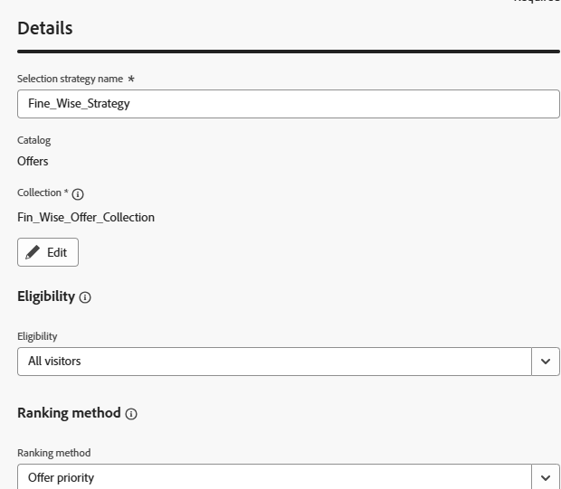

# Créer une stratégie de sélection

Une stratégie de sélection est une configuration réutilisable qui combine une collection d’offres avec des règles d’éligibilité et une méthode de classement afin de déterminer les offres à afficher lorsque la stratégie est utilisée dans une politique de décision.

Pour créer une stratégie de sélection

* Connexion à Journey Optimizer

* Accédez à Prise de décision ->Configuration de la stratégie ->Stratégies de sélection ->Créer une stratégie de sélection

* Indiquez le nom de la stratégie de sélection, la collection, l’éligibilité et la méthode de classement, comme illustré dans la capture d’écran

